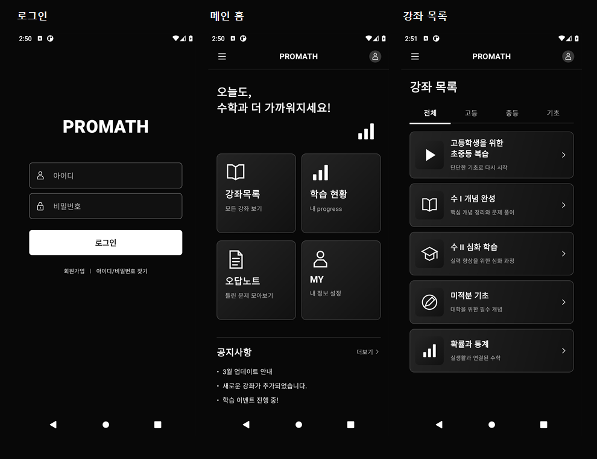

# PROMATH — 흑백 목업 UI

[Android 설치 파일 다운로드](https://github.com/k01020774181-wq/promath-mvp/releases/download/v0.3.0-ui/PROMATH-ui.apk)

[GitHub 프로젝트](https://github.com/k01020774181-wq/promath-mvp)



참고자료의 검정 배경·흰색 목업을 기준으로 새로 작성한 Kotlin + Jetpack Compose 화면 셋업입니다.
이전 앱의 모델·문항·채점·진도 저장 코드는 사용하지 않습니다.

## 화면

로그인 → 메인 홈 → 강좌 목록 → 단계 선택 → 차시 선택 → 차시 상세 → 강의/테스트 → 결과.

- 로그인: 중앙 PROMATH 로고, 아이디·비밀번호 입력, 흰색 로그인 버튼.
- 홈: 인사 문구와 막대 아이콘, 2×2 메뉴 카드, 공지사항.
- 강좌: 전체·고등·중등·기초 탭, 회색 아이콘 카드 5개.
- 단계: 8개 단계와 빗금 진행 막대, 완료·선택·잠금 표시.
- 차시: 3-1~3-8 목록, 3-3 선택 강조, 완료·잠금 아이콘.
- 상세: 문서 아이콘, 제목, 설명, 강의 시작·바로 테스트 버튼.
- 강의: 빈 개념·예시 영역, 예제 번호, 힌트 카드, 최종 테스트 이동.
- 테스트: 20개 번호와 시작 버튼, 빈 문제 영역, 결과 화면 이동.
- 결과: 목업의 통과·재도전 카드와 이동 버튼.

강의·테스트는 가로 화면이며 나머지는 세로 화면입니다.
화면 전환·탭·예제 번호 선택을 확인할 수 있습니다. 표시된 완료율과 잠금은 시안의 고정 상태입니다.
실제 강의 콘텐츠, 시험 문항, 인증, 채점, 해금, 저장 기능은 이번 UI 셋업에 포함하지 않습니다.

## 실행

Android Studio에서 이 폴더를 열고 JDK 17, SDK 35로 동기화한 뒤 `app`을 실행합니다.
최소 지원은 Android 8.0 / API 26입니다. 로그인 버튼으로 홈 화면에 진입합니다.

```powershell
.\gradlew.bat :app:assembleDebug :app:lintDebug
```

Windows에서 한글 경로 문제로 빌드가 안 되면 소스와 Gradle 사용자 캐시를 영문 경로로 복사하여 빌드합니다.
기기별 SDK 위치는 `local.properties`에서 설정합니다. 압축본에는 해당 파일을 포함하지 않습니다.

## 코드

- `MainActivity.kt`: 앱 시작과 검정 시스템 바.
- `ui/Design.kt`: 흑백 팔레트, 카드, 직접 그린 선 아이콘, 빗금 막대.
- `ui/MockupApp.kt`: 9개 화면과 이동.

참고 원본은 상위 `참고자료` 폴더에 보관합니다.
